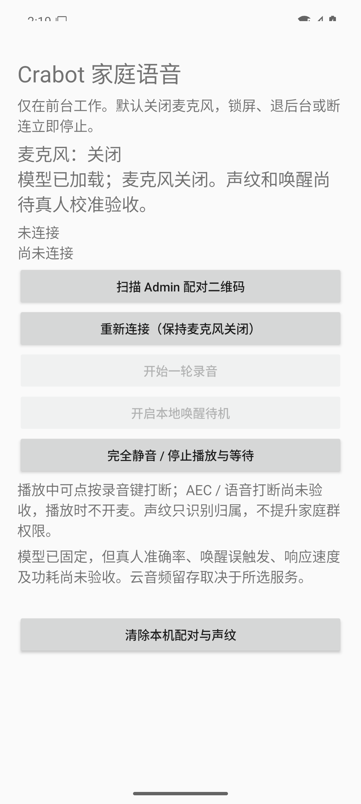

# Android Voice v1 验证记录

日期：2026-10-11。这是联调阶段记录，不是客厅产品验收通过。

## 构建物与版本

| 项目 | 实际值 |
|---|---|
| 客户端实现源码 | `0260b3f8dac4faf7741498cf911145507a7a12d6`，`feat/android-voice-v1`；含关闭后 JNI 回归修正 |
| APK | `com.crabot.voice`，`versionName=0.1.0`，`versionCode=1`，Android 29+ / ARM64 |
| APK 大小 | 54,542,809 bytes，约 52 MiB |
| APK SHA-256 | `a3f7fad74253b7283b96fc5b32ac9d7d730d7865045d8f0e670a794090f7a7e6` |
| 签名 | Android Debug；`apksigner verify` 通过，证书 SHA-256 `8b20f31fe89d9cd746c9049cf6d8305ea79a3ebabb7aa4c852328550cdee0af0` |
| 构建基线 | JDK 17 / Gradle Wrapper 8.11.1 / AGP 8.9.2 / Kotlin 2.1.20 / SDK 35 / NDK 28.2.13676358 / CMake 3.22.1 |
| 终端协议 | 正式 `protocol-voice.md` v0.1.0；终端整数版本 `1` |
| 后端 | `crabot-channel-voice` 0.1.0 的隔离实施分支；尚未与实际 APK 完整联调，不宣称已有可部署配套版本 |

端侧模型 ID、单文件和 archive checksum 均冻结，见 `Models.kt`、`model-files.json`、`prepare-models.py`；实际 JNI 使用官方 sherpa-onnx 1.13.8。模型与 NOTICE 已检查实际 APK 条目；产品包没有公开测试 WAV、用户录音、登记向量、Provider 凭据或签名私钥。源码不提交本机路径配置。debug 签名来自构建机器，APK hash 是本次构建标识，不承诺不同机器签出的字节相同。

## 已验证

| 验证 | 实际结果及范围 |
|---|---|
| 仓库 Wrapper 构建 | 首次下载官方固定分发，SHA 校验后 `:app:assembleDebug :app:testDebugUnitTest` 通过；正常构建未重写 artifact verification |
| JVM | 4/4 通过；UUID/PCM 头与顺序、非法长度、非有限分段、短片段和重叠保留。不是声纹准确率测试 |
| 实际 ARM64 JNI | 禁音频、可丢弃 Android 16 模拟器；公开合成固定句实际运行 VAD、FP32 分段、CAM++ 提取与 native 相同向量比对；同时初始化 KWS 模型和默认词。未验证真人唤醒命中率 |
| Keystore | 模拟器实际 AES-GCM/AtomicFile 保存、重新读取及删除；文件不含固定测试凭据明文。代码要求 `ranchu` 和显式 `disposable_voice_test=true`，不清理真机数据 |
| WSS 配对 | 实际本地 TLS/MockWebServer：等待 human 核对超过 5 秒仍保持连接，不发送未认证心跳；收到认证 hello 后恢复 2 秒心跳 |
| TLS pin | 证书指纹不同，握手失败，未发送 credential 或应用请求；没有回退 HTTP 或忽略证书 |
| JNI 关闭路径 | 实际释放模型后，reset/feed/segments/embedding/matches 均在 JNI 前抛关闭异常；重复 close 安全。防止取消后计算继续访问空 native handle；不等同真机生命周期验收 |
| 仪器测试总计 | 上述 JNI/Keystore/连接测试 5/5 通过，约 11.7 秒；无麦克风授权、无主机音频、无云接口、无真实业务执行 |
| 实际启动界面 | 模型加载完成，仍显示关麦，未配对时禁用录音/唤醒按钮；系统栏布局已核对。截图如下 |

配对回归发现并修正了“人工确认后未恢复心跳”的连接问题。最终 diff 同时收口排队/路由/焦点/模型加载取消时的资源路径，并补齐关闭后的 JNI 入口检查；这些检查不能代替真机 AudioRecord/AudioTrack 释放和实际播放证据。已做本次代码的简化与完整 diff 自审；上游 NOTICE 原文和生成的 Windows Wrapper CRLF 保留，不按应用代码空白规则改写。

## 未验证及继续条件

当前 ADB 只有专用测试模拟器，未连接用户手机。尚未安装产品 APK 到 OnePlus 7 Pro，也未读取或迁移旧实验 App 的 FuFu 声纹。

- 真机按钮采音/扬声器播放、锁屏/退后台/焦点/路由释放和真实完成回执。
- 两人独立登记的 A→B / A→B→A、短接话、未知及撤销；当前 score 0.50、margin 0.08、最少簇语音 1.5 秒是未校准研究值，不能报告准确率或场景 B 可用率已达标。
- 客厅距离、电视/音乐/自播各一小时误唤醒、AEC 效果及语音打断。当前严格保持播放关麦和按钮打断。
- 50 轮整链 median/P95，以及 30 分钟温度、电量、PSS；上述 11.7 秒为测试运行时间，不是语音响应时间。
- 真实 Voice Channel 与 APK 的完整配对、登记、ASR/Manager/TTS、恢复及 system mode 两 UID 隔离。

后端审查已复现事件中的 Friend metadata 不受原 turn digest 保护。[授权来源补充设计](https://github.com/smilefufu/crabot-docs/blob/main/superpowers/specs/2026-10-11-voice-authorized-batch-source-design.md)待用户书面确认后才能改正式协议/实现；其收口及整链验证完成前不部署当前后端 WIP。手机不增加 Provider/Admin 配置来绕过此边界。

手机接入后先验证单人录放音、生命周期、短句和等待/打断；家庭成员到场再做 spec 的真人 B 和未知测试。所有未通过项继续标为待验收，不以模拟器或旧文件实验替代。
